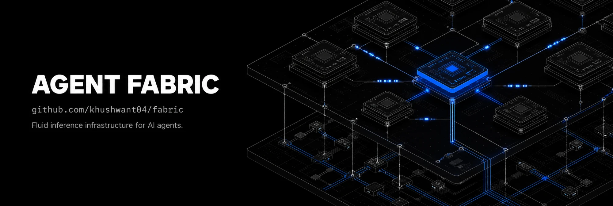
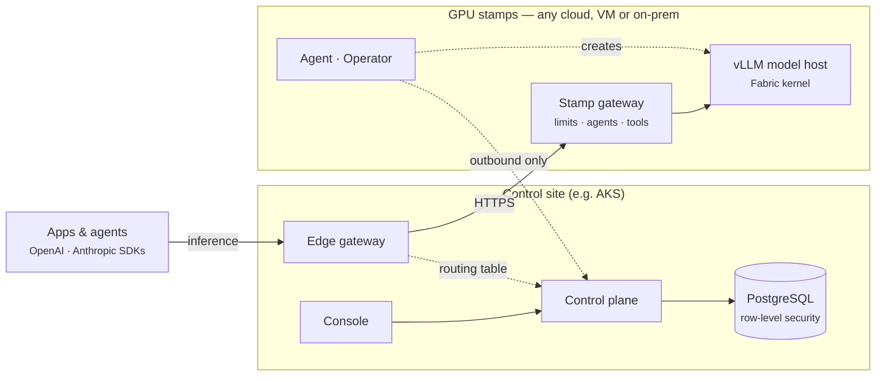

<p align="center">
  
</p>

<p align="center">
  A managed inference platform for open models, built for agents: OpenAI- and Anthropic-compatible
  APIs on GPUs you run anywhere, with tenant isolation, routing, limits and metering handled for you.
</p>

<p align="center">
  <a href="https://github.com/khushwant04/fabric/commits/main"></a>
  
  
  
  
  <a href="LICENSE"></a>
</p>

<p align="center">
  <a href="#quick-start">Quickstart</a> ·
  <a href="docs/getting-started.md">Deploy</a> ·
  <a href="#documentation">Docs</a> ·
  <a href="docs/architecture/README.md">Architecture</a> ·
  <a href="docs/context/roadmap.md">Roadmap</a>
</p>

---

Fabric gives customers OpenAI- and Anthropic-compatible APIs on GPUs you run anywhere —
AKS node pools, k3s on cloud VMs, or on-prem machines — and handles tenant isolation,
routing, limits, metering and rollout for you. Inference never passes through the control
plane, so serving keeps working when the control plane does not.

## Highlights

**APIs your SDKs already speak**
- OpenAI `/v1/chat/completions`, `/v1/completions`, `/v1/responses` and `/v1/models`, with streaming
- Anthropic `/v1/messages`, with tools, images and streaming
- The OpenAI Agents SDK, unmodified — tools, handoffs, guardrails, structured output

**Built for agent loops**
- **Agent runs** — token and step budgets per run, a per-step trace, and a tool-call guard that repairs malformed tool arguments before your code sees them
- **Server-side tool loop** — one request runs a whole agent; the gateway calls the model, runs tools in parallel and streams every step
- **Hosted tools** — code interpreter (E2B or an isolated sandbox), web search and fetch, file search with citations, and MCP connectors with per-call approval
- **Model cascade** — answer with the smallest model, escalate only when a cheap check fails

**Run it anywhere, serve it from one URL**
- **Stamps** — any Kubernetes cluster with GPUs enrolls with a single-use token and connects outbound only
- **Edge gateway** — one inference URL across every stamp, with failover, run affinity, and serving through a control-plane outage
- **Declarative deployments** — capacity-aware placement, zero-downtime rollouts, and hardware-aware model-host settings

**Enterprise foundations**
- PostgreSQL row-level security on every account table, under a role that cannot bypass it
- API keys for machines, OIDC for people, and a per-account identity provider
- Request, token-rate and concurrency limits; metering from the model's own token counts
- Transactional audit trail with export; stamp credential rotation; Prometheus and Grafana

**GPU runtime**
- A fused Triton gated-delta decode kernel for Qwen3.5-class models, with per-GPU launch tuning for T4 and A10 and automatic fallback to the engine's kernel

## Architecture



The control plane owns accounts, credentials, deployments and placement. Each stamp runs an
agent that pulls desired state outbound, an operator that runs the model hosts, and a gateway
that verifies tokens locally and serves requests. More views, including an editable draw.io
diagram, are in [docs/architecture](docs/architecture/README.md).

## Quick start

### Run the whole platform locally — no GPU, no cluster

Requires [uv](https://docs.astral.sh/uv/), Go 1.24+, `curl` and `openssl`.

```bash
make demo
```

This runs a real control plane, the Go agent and usage collector, and the gateway in front of a
stub model host. It enrolls a stamp, places a deployment, serves an authorized request, refuses
a forged token and meters the usage exactly once. Point `FABRIC_E2E_UPSTREAM` at any
OpenAI-compatible server to use a real model.

| Demo | Shows |
|---|---|
| `make demo-console` | The console against a local platform with a seeded account |
| `make demo-agent` | A multi-step agent with a budget, trace and tool-call repair |
| `make demo-agent-loop` | A whole agent in one request on the gateway |
| `make demo-hosted-tools` | Code interpreter, web search and web fetch |
| `make demo-file-search-mcp` | File search with citations and an approval-gated MCP tool |
| `make demo-openai-agents` | The OpenAI Agents SDK running on Fabric |
| `make demo-cascade` | Small model first, escalation on failed checks |
| `make demo-edge` | One URL over two stamps, failover, control-plane outage |

### Call a deployed Fabric

```bash
cp examples/.env.example examples/.env   # set FABRIC_CONTROL_URL, FABRIC_INFERENCE_URL, FABRIC_API_KEY
set -a; source examples/.env; set +a
uv run --project examples/python python examples/python/scripts/chat.py
```

The examples exchange an API key for a short-lived inference token, so the key itself never
reaches a gateway. See the [examples guide](examples/README.md) for streaming, tools, vision,
audio and agents.

### Install on Kubernetes

| Goal | Guide |
|---|---|
| A complete single-tenant install with Helm | [Single-tenant installation](docs/single-tenant-installation.md) |
| Run components yourself, or enroll a cluster as a stamp | [Getting started](docs/getting-started.md) |
| Put one URL in front of every stamp | [Edge gateway](docs/edge-gateway.md) |
| Expose a stamp's gateway over HTTPS | [Stamp endpoints](docs/stamp-native-endpoint.md) |
| Roll a release out to existing stamps | [Release runbook](docs/demo-runbook.md) |

Release images are published by CI to `public.ecr.aws/hexelstudio/fabric/<component>:git-<sha>`.

## Repository layout

| Path | Contents |
|---|---|
| [`control-plane/`](control-plane/) | FastAPI control plane: accounts, credentials, deployments, placement, audit |
| [`data-plane/`](data-plane/) | Stamp gateway and edge gateway: auth, routing, limits, agents, hosted tools |
| [`agent/`](agent/) | Go agent, operator and usage collector that run in each stamp |
| [`sandbox/`](sandbox/) | Isolated code-execution service for the code interpreter |
| [`v1/`](v1/) | Next.js console |
| [`runtime/`](runtime/) | Triton kernels, dispatch, launch tuning and benchmark harness |
| [`serving/`](serving/) | vLLM integration and kernel registration |
| [`deploy/`](deploy/) | Container images, Helm charts, observability |
| [`examples/`](examples/) | Python and curl clients |
| [`docs/`](docs/) | Guides, design, architecture decision records |
| [`paper/`](paper/) | Technical papers and their figure pipeline |

## Development

```bash
make check      # every test and lint suite CI runs
make help       # all targets
```

CI runs on every pull request: the control plane on SQLite and on PostgreSQL as a role without
`BYPASSRLS`, the data plane, sandbox, runtime and serving suites on CPU, the Go agent, the
console (lint, typecheck, tests, image build), Helm chart checks, and the end-to-end platform
loops. See [CONTRIBUTING.md](CONTRIBUTING.md).

## Project status

The platform runs in production on NVIDIA T4 GPUs, with A10 and RTX PRO 6000 stamps being
added. GPU node provisioning and DNS remain outside Fabric. Hosted tools, the edge gateway and
the agent features are new and validated with automated tests and local end-to-end demos; the
kernel is measured at the operation level only. Measured numbers, and what they do not claim,
are in [Measured results](docs/measured-results.md); planned work is in the
[roadmap](docs/context/roadmap.md).

## Documentation

**Using Fabric** —
[Examples](examples/README.md) ·
[Responses API](docs/openai-responses.md) ·
[Messages API](docs/anthropic-messages.md) ·
[OpenAI Agents SDK](docs/openai-agents-sdk.md) ·
[Agent runs](docs/agent-runs.md) ·
[Tool loop](docs/agent-tool-loop.md) ·
[Hosted tools](docs/hosted-tools.md) ·
[File search](docs/file-search.md) ·
[MCP connectors](docs/mcp-connectors.md) ·
[Model cascade](docs/model-cascade.md)

**Operating Fabric** —
[Single-tenant installation](docs/single-tenant-installation.md) ·
[Getting started](docs/getting-started.md) ·
[Deployment record](docs/deployment.md) ·
[Edge gateway](docs/edge-gateway.md) ·
[Console](docs/console-agents.md) ·
[Console demo](docs/console-demo.md) ·
[Kernel tuning](docs/kernel-tuning-t4-a10.md) ·
[Observability](docs/context/observability-slos.md) ·
[Security and identity](docs/context/security-identity.md)

**Design** —
[Architecture](docs/architecture/README.md) ·
[Project review](docs/project-review.md) ·
[System design](docs/context/system-design.md) ·
[Current state](docs/context/current-state.md) ·
[Decision records](docs/context/adrs/README.md) ·
[Air-gapped design](docs/airgapped-onprem-design.md) ·
[Context index](docs/context/README.md)

**Research** —
[Measured results](docs/measured-results.md) ·
[Model optimization](docs/model-optimization.md) ·
[Papers](paper/README.md)

Code is the source of truth: documentation describes what is implemented, planned work is
labelled as planned, and performance claims stay tied to reproducible artifacts on named
hardware.

## Contributing and security

Contributions are welcome — see [CONTRIBUTING.md](CONTRIBUTING.md). Report vulnerabilities
privately as described in [SECURITY.md](SECURITY.md).

## License

Fabric is licensed under the [Apache License 2.0](LICENSE). Copyright and attribution
notices are in [NOTICE](NOTICE).
