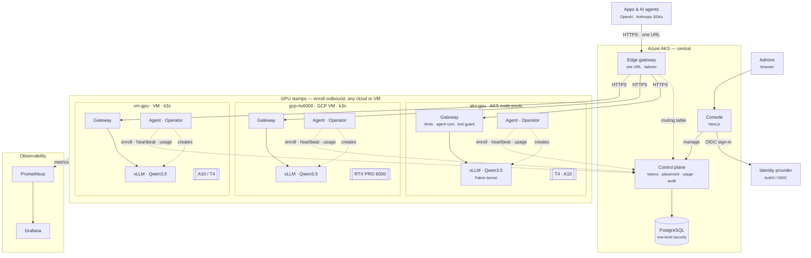

# Fabric architecture

Three views of the same architecture. The control plane and edge gateway run on Azure AKS;
GPU stamps run on AKS node pools, Google Cloud VMs and other VMs. Each stamp enrolls with
the control plane over outbound connections only, and inference never passes through the
control plane.

- [`fabric-architecture.drawio`](fabric-architecture.drawio): editable diagram with cloud
  icons. Open it at [app.diagrams.net](https://app.diagrams.net) (File → Open from → Device).
- The Mermaid diagram below renders on GitHub.
- The plain-text diagram below works anywhere, including terminals and code review.

## Mermaid



## Plain text

```
                     ┌──────────────────────────┐            ┌──────────────┐
                     │   Apps & AI agents       │            │   Admins     │
                     │ OpenAI / Anthropic SDKs  │            │  (browser)   │
                     └────────────┬─────────────┘            └──────┬───────┘
                                  │ HTTPS · one URL                 │
┌─────────────────────────────────┼─────────────────────────────────┼─────────────┐
│  Azure AKS — central            ▼                                 ▼             │
│                       ┌───────────────────┐            ┌───────────────────┐    │
│                       │   Edge gateway    │            │     Console       │    │   ┌───────────────┐
│                       │ one URL           │            │     Next.js       │────┼──►│ Identity      │
│                       │ verify token ·    │            └─────────┬─────────┘    │   │ provider      │
│                       │ pick stamp ·      │                      │ manage       │   │ Auth0 / OIDC  │
│                       │ failover · run    │ routing    ┌─────────▼─────────┐    │   └───────────────┘
│                       │ affinity          │┈┈table┈┈┈┈►│  Control plane    │    │
│                       └─────────┬─────────┘            │ tokens · placement│    │
│                                 │                      │ usage · audit     │    │
│                                 │                      └─────────┬─────────┘    │
│                                 │                      ┌─────────▼─────────┐    │
│                                 │                      │ PostgreSQL (RLS)  │    │
│                                 │                      └─────────▲─────────┘    │
└─────────────────────────────────┼────────────────────────────────┼──────────────┘
                                  │ HTTPS                          ┊ enroll · heartbeat · usage
                                  │                                ┊ (outbound only)
┌─────────────────────────────────▼────────────────────────────────┴──────────────┐
│  GPU stamps — each cluster enrolls outbound, on any cloud or VM                 │
│                                                                                 │
│  ┌── aks-gpu (AKS pools) ──┐  ┌── gcp-rtx6000 (GCP·k3s) ─┐  ┌── vm-gpu (VM·k3s) ─┐ │
│  │ Gateway ──► vLLM        │  │ Gateway ──► vLLM         │  │ Gateway ──► vLLM   │ │
│  │   limits    Qwen3.5     │  │             Qwen3.5      │  │             Qwen3.5│ │
│  │   agent runs  ▲         │  │               ▲          │  │               ▲    │ │
│  │ Agent·Operator┘         │  │ Agent·Operator┘          │  │ Agent·Operator┘    │ │
│  │ GPU: T4 · A10           │  │ GPU: RTX PRO 6000        │  │ GPU: A10 / T4      │ │
│  └─────────────────────────┘  └──────────────────────────┘  └────────────────────┘ │
└──────────────────────────────────────┬──────────────────────────────────────────┘
                                       │ metrics
                              ┌────────▼────────┐
                              │ Prometheus ──►  │
                              │ Grafana         │
                              └─────────────────┘

  ──►  request / data          ┈┈►  control or sync
```

## What each part does

| Part | Runs on | Role |
|---|---|---|
| Edge gateway | AKS | One inference URL. Verifies the token locally, forwards to a healthy stamp holding the model, keeps run-id affinity, serves from a cached routing table if the control plane is down. See [edge gateway](../edge-gateway.md). |
| Console | AKS | Next.js admin UI: deployments, stamps, usage, audit, access, playground. |
| Control plane | AKS | Accounts, API keys, OIDC, token exchange, deployments, capacity-aware placement, stamp enrollment, usage and audit. |
| PostgreSQL | AKS | Account data with row-level security forced on every account table. |
| Stamp gateway | Each stamp | OpenAI, Responses and Anthropic Messages APIs; limits; agent runs, tool-call guard, tool loop and model cascade; metering. |
| Agent · Operator | Each stamp | Enrolls and heartbeats outbound; reconciles deployments into vLLM pods with zero-downtime rollouts; forwards usage. |
| vLLM host | Each stamp | Serves Qwen3.5 with the Fabric Triton gated-delta kernel (per-GPU launch table on T4/A10). |
| Observability | Any | Prometheus and Grafana over engine, gateway, GPU and agent-run metrics. |
