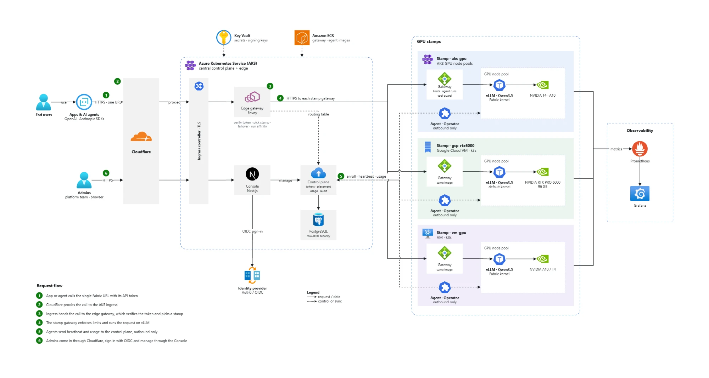
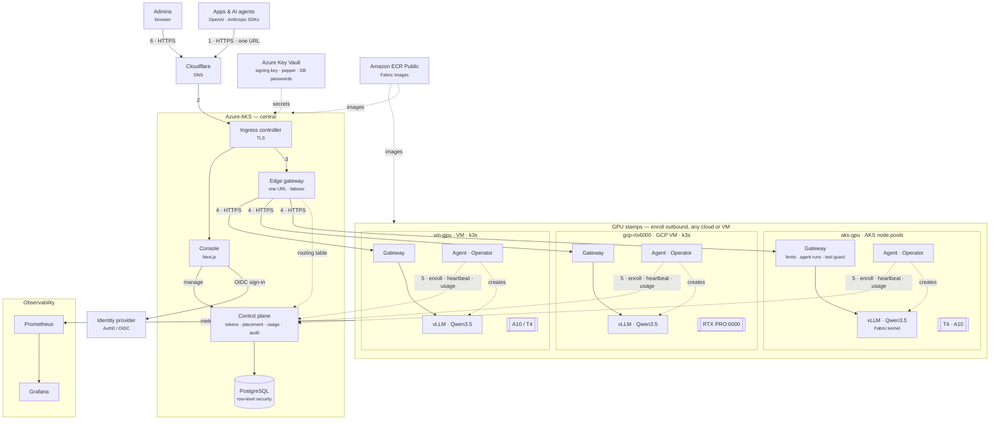

# Fabric architecture



The control plane, console and edge gateway run on Azure AKS behind an ingress controller,
with Cloudflare in front for DNS. GPU stamps run on AKS node pools, Google Cloud VMs and
other VMs. Each stamp enrolls with the control plane over outbound connections only, and
inference never passes through the control plane. Secrets come from Azure Key Vault, and
every Fabric image is pulled from Amazon ECR Public.

The diagram above is the reference view. The same architecture is also available as:

- [`fabric-architecture.drawio`](fabric-architecture.drawio): an editable diagram with cloud
  icons. Open it at [app.diagrams.net](https://app.diagrams.net) (File → Open from → Device).
- The Mermaid diagram below, which renders on GitHub.
- The plain-text diagram below, which works anywhere, including terminals and code review.

## Request flow

1. An app or agent calls the single Fabric inference URL with its Fabric token.
2. Cloudflare resolves (and, if proxied, forwards) the call to the AKS ingress controller.
3. The ingress hands the call to the edge gateway, which verifies the token locally and picks
   a healthy stamp that holds the requested model for the caller's account.
4. The stamp's gateway enforces limits, runs agent and tool logic, and serves the request on
   vLLM.
5. Each stamp's agent sends enrollment, heartbeats and usage to the control plane — outbound
   only.
6. Admins reach the console through the same front door, sign in with OIDC, and manage
   deployments, stamps and access through the control plane.

## Mermaid



## Plain text

```
              ┌──────────────────────────┐                 ┌──────────────┐
              │   Apps & AI agents       │                 │   Admins     │
              │ OpenAI / Anthropic SDKs  │                 │  (browser)   │
              └────────────┬─────────────┘                 └──────┬───────┘
                           │ 1 HTTPS · one URL                    │ 6 HTTPS
                           ▼                                      ▼
              ┌────────────────────────────────────────────────────────────┐
              │  Cloudflare (DNS)                                          │
              └────────────────────────────┬───────────────────────────────┘
                                           │ 2
┌──────────────────────────────────────────▼──────────────────────────────────────┐   ┌──────────────────┐
│  Azure AKS — central            ┌───────────────────────────┐                   │◄┈┈┤ Azure Key Vault  │
│                                 │  Ingress controller · TLS │                   │   │ signing key ·    │
│                                 └──────┬───────────────┬────┘                   │   │ pepper · DB pwd  │
│                                      3 │               │                        │   └──────────────────┘
│                       ┌────────────────▼──┐      ┌─────▼─────────────┐          │   ┌───────────────┐
│                       │   Edge gateway    │      │     Console       │──────────┼──►│ Identity      │
│                       │ verify token ·    │      │     Next.js       │  OIDC    │   │ provider      │
│                       │ pick stamp ·      │      └─────────┬─────────┘          │   │ Auth0 / OIDC  │
│                       │ failover · run    │ routing        │ manage             │   └───────────────┘
│                       │ affinity          │┈┈table┈┈┐  ┌──▼────────────────┐   │
│                       └─────────┬─────────┘         └┈►│  Control plane    │   │
│                                 │                      │ tokens · placement│   │
│                                 │                      │ usage · audit     │   │
│                                 │                      └─────────┬─────────┘   │
│                                 │                      ┌─────────▼─────────┐   │
│                                 │                      │ PostgreSQL (RLS)  │   │
│                                 │                      └─────────▲─────────┘   │
└─────────────────────────────────┼────────────────────────────────┼─────────────┘
                                  │ 4 HTTPS                        ┊ 5 enroll · heartbeat · usage
                                  │                                ┊   (outbound only)
┌─────────────────────────────────▼────────────────────────────────┴──────────────┐
│  GPU stamps — each cluster enrolls outbound, on any cloud or VM                 │
│                                                                                 │
│  ┌── aks-gpu (AKS pools) ──┐  ┌── gcp-rtx6000 (GCP·k3s) ─┐  ┌── vm-gpu (VM·k3s) ─┐ │
│  │ Gateway ──► vLLM        │  │ Gateway ──► vLLM         │  │ Gateway ──► vLLM   │ │
│  │   limits    Qwen3.5     │  │             Qwen3.5      │  │             Qwen3.5│ │
│  │   agent runs  ▲         │  │               ▲          │  │               ▲    │ │
│  │ Agent·Operator┘         │  │ Agent·Operator┘          │  │ Agent·Operator┘    │ │
│  │ GPU: T4 · A10           │  │ GPU: RTX PRO 6000        │  │ GPU: A10 / T4      │ │
│  └─────────────────────────┘  └──────────────────────────┘  └────────────────────┘ │
└──────────────────────────────────────┬──────────────────────────────────────────┘
                                       │ metrics             Images for AKS and every
                              ┌────────▼────────┐            stamp: Amazon ECR Public
                              │ Prometheus ──►  │            (public.ecr.aws/hexelstudio/fabric)
                              │ Grafana         │
                              └─────────────────┘

  ──►  request / data          ┈┈►  control or sync          1–6  request flow steps
```

## What each part does

| Part | Runs on | Role |
|---|---|---|
| Cloudflare | Edge | DNS for the public hostnames. Keep the inference hostname DNS-only (or use streaming-only clients): Cloudflare's 100 s origin timeout on non-Enterprise plans cuts off long non-streaming generations ([deployment record](../deployment.md)). |
| Ingress controller | AKS | Terminates TLS and routes to the edge gateway and console (Istio's external gateway in the deployed environment). |
| Edge gateway | AKS | Fabric's own gateway service (`data-plane/fabric_data_plane/edge`). One inference URL: verifies the token locally, forwards to a healthy stamp holding the model, keeps run-id affinity, serves from a cached routing table if the control plane is down. See [edge gateway](../edge-gateway.md). |
| Console | AKS | Next.js admin UI: deployments, stamps, agents, usage, audit, access, playground. |
| Control plane | AKS | Accounts, API keys, OIDC, token exchange, deployments, capacity-aware placement, stamp enrollment, usage and audit. |
| PostgreSQL | AKS | Account data with row-level security forced on every account table. |
| Azure Key Vault | Azure | Signing key, credential pepper, database passwords and other platform secrets. |
| Amazon ECR Public | AWS | Release images for every component, published by CI as `public.ecr.aws/hexelstudio/fabric/<component>:git-<sha>`. |
| Stamp gateway | Each stamp | OpenAI, Responses and Anthropic Messages APIs; limits; agent runs, tool-call guard, tool loop, hosted tools and model cascade; metering. |
| Agent · Operator | Each stamp | Enrolls and heartbeats outbound; reconciles deployments into vLLM pods with zero-downtime rollouts; forwards usage. |
| vLLM host | Each stamp | Serves Qwen3.5 with the Fabric Triton gated-delta kernel (per-GPU launch table on T4/A10). |
| Observability | Any | Prometheus and Grafana over engine, gateway, GPU and agent-run metrics. |
