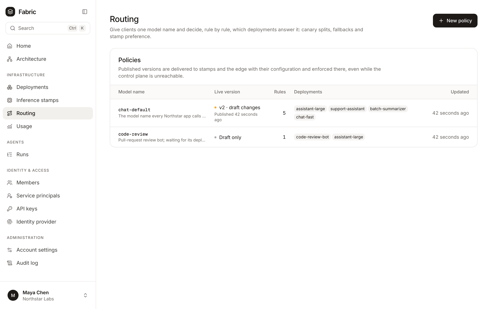
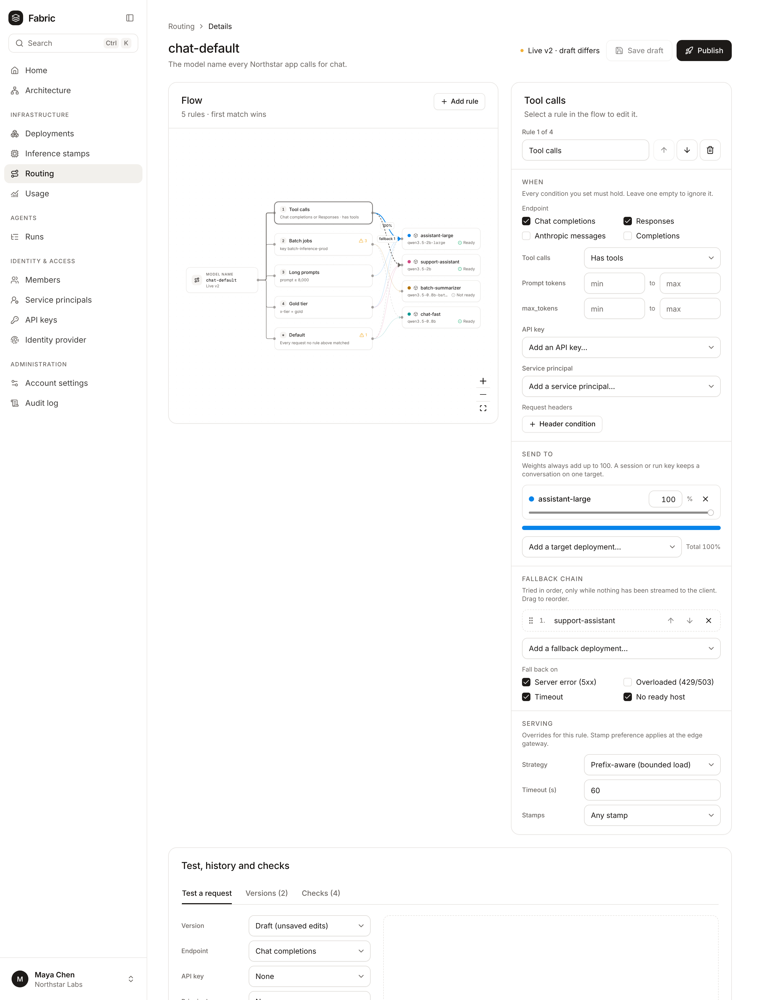
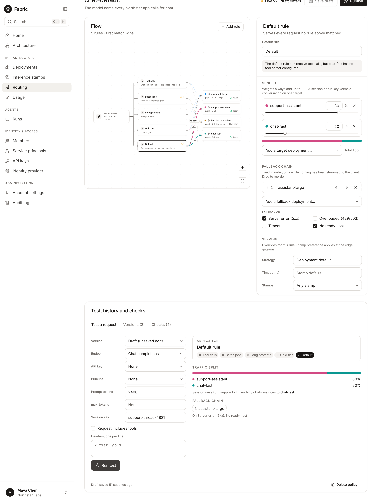

# Routing policies

A routing policy gives clients one model name, such as `chat-default`, and lets the account
decide which deployments answer it. Rules are tried in order and the first match decides;
a default rule catches everything else. Each rule splits traffic across deployments by
weight, names a fallback chain, and can prefer stamps, pick a backend strategy and set a
timeout.

The decision is recorded in [ADR 0023](context/adrs/0023-routing-policies-from-cached-snapshots.md).
Code: `data-plane/fabric_data_plane/routing_policy.py` (shared, byte-identical with
`control-plane/app/core/routing_policy.py`), `policy_routing.py` (stamp gateway),
`edge/policy.py` (edge), `control-plane/app/services/routing_policies.py`, and the console's
**Routing** page.

```
client: model "chat-default"
        |
        v
   +---------+   rule 1  has tools            -> assistant-large 100%   fallback: support-assistant
   | policy  |   rule 2  key batch-inference  -> batch-summarizer 100%  fallback: chat-fast
   | (first  |   rule 3  prompt >= 8000       -> assistant-large 100%   prefer stamp gcp-rtx6000
   |  match) |   rule 4  x-tier = gold        -> assistant-large 70% / support-assistant 30%
   +---------+   default                      -> support-assistant 90% / chat-fast 10% (canary)
```

## Rules

**Conditions** (all optional; every one that is set must hold):

| Condition | Matches |
|---|---|
| API key | The API key the inference token was exchanged from (`key_id` claim) |
| Service principal | The token's subject |
| Request header | `equals` a value, or `regex` (searched; first 1024 characters of the value) |
| Endpoint | `chat_completions` (also agent runs), `responses`, `messages` (Anthropic), `completions` |
| Has tools | The request declares `tools` (or explicitly does not) |
| Prompt tokens | Estimated at four characters per token over the prompt text, inclusive range |
| max_tokens | `max_output_tokens`, `max_completion_tokens` or `max_tokens`; a request without one does not match a max_tokens condition |

Embeddings are not a public endpoint of the gateway, so they cannot be routed by policy.

**Actions:**

| Action | Meaning |
|---|---|
| Targets | 1–10 deployments of the account with integer weights summing to 100. Weight 0 drains a target. |
| Fallbacks | Up to 5 deployments tried in order after the chosen target. A fallback may not repeat a target or an earlier fallback (that would be a cycle). |
| Fall back on | `server_error` (5xx from the host, or a host failure after the request may have started), `overload` (429 or 503 from the host), `timeout`, `no_ready_host`. Default: `server_error`, `no_ready_host`. |
| Stamp preference | `prefer` tries the listed stamps first; `pin` sends only to them. Applied by the edge gateway, which is the only component choosing between stamps. |
| Strategy | `prefix_aware` (ADR 0019) or `least_in_flight` for the target's backends; unset keeps the deployment's own. |
| Timeout | Upstream timeout in seconds for this rule; unset keeps the stamp's. |

## The weighted split

The target is drawn with weighted rendezvous hashing over a key:

1. `X-Fabric-Run-Id` (a run lives on one stamp),
2. otherwise the session key: `X-Fabric-Session`, `X-Session-Id`, `X-Conversation-Id`, or the
   body's `user` — the same keys prefix-aware routing uses,
3. otherwise `X-Fabric-Route-Key`, which the edge sets when it drew the target itself,
4. otherwise a random key per request.

So every request of a conversation reaches the same deployment and its prefix cache stays
warm, while anonymous traffic spreads by weight. Raising a canary from 10% to 20% moves
only the sessions that must move. Only deployments the stamp serves are eligible there; the
weights of the others are renormalised, and because of how rendezvous hashing works, a
stamp picks exactly the target the edge picked whenever it holds it.

## Fallbacks and retries

A request moves down the chain only on the rule's conditions and only while nothing has
been sent to the client:

* A non-streamed answer that fails a listed condition is discarded and the next deployment
  is tried. A 4xx (other than 429) is returned as is.
* A streamed response is never retried once it has started. A stream can still fall back
  before it starts, when the target has no reachable model host.
* The account's own rate, token and concurrency limits, and a stamp that cannot record
  usage, are returned without falling back: another deployment on the stamp would fail
  the same way.
* Within one deployment the gateway still retries another model host only after a
  connection failure, as before.

`timeout` and `server_error` fallbacks may run a request twice: the first host may still be
working when the next one starts. Every attempt is admitted, metered and charged.

Responses carry: `X-Fabric-Policy`, `X-Fabric-Policy-Version`, `X-Fabric-Policy-Rule`,
`X-Fabric-Policy-Target`, `X-Fabric-Policy-Fallbacks` and, after a fallback,
`X-Fabric-Policy-Fallback-Reason` (for example `no_ready_host>server_error`).

## How a policy reaches the gateways

Nothing on the request path asks the control plane.

* **Stamps.** Every desired-state pull returns `routing_policies {revision, policies}`: the
  live versions of each account with a deployment placed on the stamp. The agent writes it
  into `deployments.json` (in operator mode, each `ModelDeployment` carries its account's
  policies and the operator writes each policy once). The gateway reloads the file and
  enforces what it holds. When the control plane is down, the file keeps the last good
  snapshot; an agent restart keeps it too.
* **Edge.** The routing table includes the same documents. Its ETag and revision cover them,
  and the edge's saved copy lets it keep routing by policy after a restart during an outage.

A policy whose document cannot be parsed is ignored and logged; its alias then behaves as
if it had no policy.

## Behaviour that does not change

* A model name that is not a policy alias is served exactly as before.
* A real deployment alias wins over a policy with the same name (the control plane refuses
  to create such a policy). `auto` and `cascade` cannot name a policy.
* A policy alias is listed by `GET /v1/models` on stamps and the edge.
* Another account's policy is never consulted: policies are looked up by the account in the
  caller's verified token.

## API

All under `/v1/accounts/{account_id}/routing-policies`; reads need `deployments:read`, writes
`deployments:write`.

| Method and path | Purpose |
|---|---|
| `GET /` | List policies with their live version and whether the draft differs |
| `POST /` | Create `{alias, description, draft}` |
| `GET /{id}` | Draft, live version, validation report |
| `PUT /{id}/draft` | Replace the draft (does not change what is live) |
| `POST /{id}/validate` | Validate a document without saving it |
| `POST /{id}/publish` | Publish the draft as a new immutable version `{note}` |
| `POST /{id}/rollback` | Republish version `{version}` as a new version |
| `GET /{id}/versions`, `GET /{id}/versions/{n}` | History |
| `POST /{id}/simulate` | Which rule a described request matches and where it goes |
| `DELETE /{id}` | Delete; the alias stops routing on the next pull |

Validation errors block publishing: weights that do not sum to 100, a rule with no target,
a deployment the account does not own (another account's deployment is reported the same
way), a fallback cycle, an invalid regular expression, an alias that collides. Warnings do
not: a rule that can receive tool calls sending to a deployment with no tool parser, a rule
with no ready target, an unreachable rule, a fallback chain with no trigger, a preferred
stamp that holds none of the rule's deployments.

### Simulate

```bash
curl -s "$CP/v1/accounts/$ACCOUNT/routing-policies/$POLICY/simulate" \
  -H "Authorization: Bearer $TOKEN" -H 'content-type: application/json' -d '{
    "source": "live",
    "request": {"endpoint": "chat_completions", "has_tools": true, "prompt_tokens": 2400,
                "headers": {"x-tier": "gold"}, "session_key": "thread-4821"}}'
```

The answer names the matched rule, the trace of every rule's result, the split in percent,
the target that session always gets, the fallback chain and the rule's overrides. It is
computed by the same module the gateways enforce with. `"document"` tests unsaved edits.

## Console

**Infrastructure → Routing** lists policies. The editor shows the policy as a flow: the
model name, the rules in match order and the target deployments, with the split weight on
each edge and dashed fallback edges (on a phone, a stacked list). Selecting a rule opens it
in the side panel: conditions, targets with weight sliders that keep the total at 100, and a
fallback chain you can drag to reorder. **Test a request** calls simulate on the draft or
the live version. **Publish** shows what changes against the live version; **Versions**
rolls back. Checks update as you edit.




